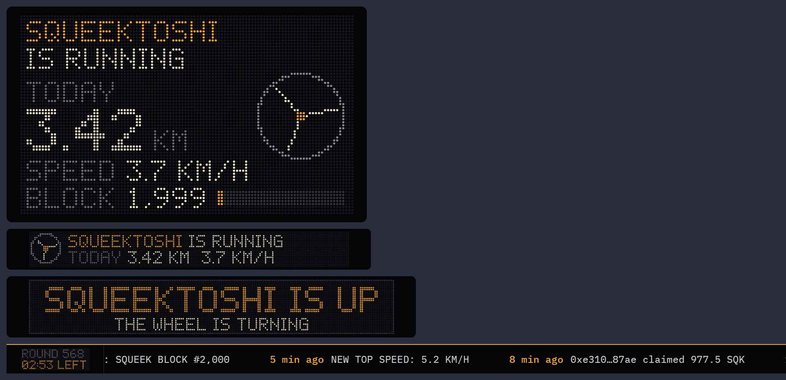
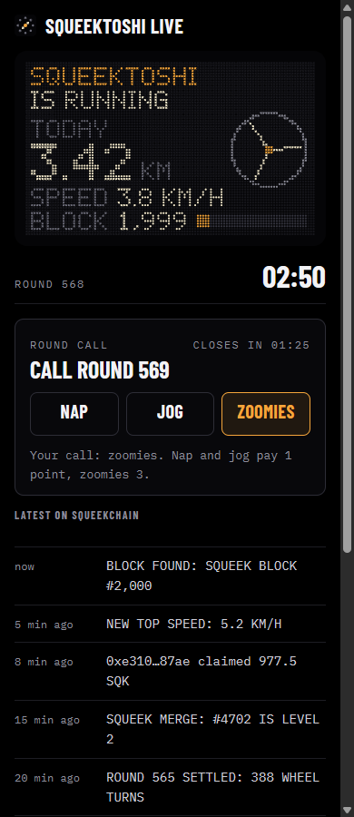

# Squeek Stream Kit

Free OBS and Streamlabs overlays for Squeekchain streams. Squeektoshi, the hamster whose wheel powers
[Squeekchain](https://squeekchain.com), on your stream: an LED board of his wheel, alerts when he wakes up, gets the
zoomies or a block is found, a round ticker for the lower third, and a second-screen page for viewers on a phone.

Built for the [Squeekchain Genesis Code Lane](https://squeekchain.com/genesis/code), category "Stream companions and
overlays". Static site, no server, no account, no API key, no wallet. Not affiliated with Squeekchain.



## Overlays

Open the setup page (`index.html`), pick the options, copy a link, and add it in OBS as a Browser source (Streamlabs:
Browser Source) at the size shown. Every overlay page is transparent.

| Overlay | Page | Source size | What it shows |
| --- | --- | --- | --- |
| LED board | `board.html` | 880 × 528 | his state, today's distance, speed, the Squeek block and its progress, a wheel that turns at his real RPM |
| LED strip | `board.html?layout=strip` | 890 × 100 | the same in two lines, for the top or bottom of the scene |
| Alerts | `alerts.html` | 1000 × 150 | one alert card at a time with a short chiptune, then nothing |
| Ticker | `ticker.html` | 1920 × 72 | the round clock and the latest Squeekchain events, scrolling |

For alert sounds tick "Control audio via OBS" and untick "Shutdown source when not visible".

### Alerts

| Alert | When | Default |
| --- | --- | --- |
| Wake up | the wheel turns again on two readings in a row after at least three minutes still | on |
| Nap | three minutes without a turn after he was running | on |
| Zoomies | at or above the threshold (4.5 km/h by default: he usually runs about 4 km/h, his record is 5.2) on two readings in a row; again only after two minutes under 80% of it | on |
| Block found | a SqueekCore settlement completes Squeek blocks | on |
| Top speed | Squeekchain records a new top speed | on |
| Distance | lifetime and daily distance milestones | on |
| Streak | days in a row over 5 km | on |
| Merge | someone merges two Squeeks | off |

Reloading a source never replays old events. If the API is down, the board keeps the last values and shows OFF AIR
after two minutes, and no wheel alerts fire.

### Options (URL parameters, every page)

| Parameter | Values | Default |
| --- | --- | --- |
| `theme` | `amber`, `green`, `ice`, `white` | `amber` |
| `layout` | `full`, `strip` (board) | `full` |
| `alerts` | comma list of `wake,nap,zoomies,block,record,distance,streak,merge`, or `none` | all but `merge` |
| `zoomies` | km/h, 1 to 10 | `4.5` |
| `sound` | `0` or `1` | `1` |
| `vol` | 0 to 100 | `60` |
| `dur` | alert seconds, 3 to 15 | `6` |
| `demo` | `1`: sample data and an alert every 8 s, for placing sources while he sleeps | off |

## Watch page

`watch.html` puts the overlays on Squeekchain's own livestream for anyone, no OBS needed: the stream plays in a 16:9
screen with the LED board and the alerts on top (they let clicks through to the player) and the ticker under it.
Pass the stream as `?youtube=VIDEO_ID`, `?twitch=CHANNEL` or `?x=BROADCAST_ID`, or paste the live link on the page;
the address then carries it, so the page can be shared as is. YouTube and Twitch use their standard embeds, X uses
`studio.x.com/embed/broadcast/…`, the same three kinds Squeekchain's site uses. The alert sound starts off and turns on
with a click (browsers need one).

## Second screen

`live.html` is for viewers on a phone: the board, the round clock, the latest events and a link to watch the wheel.



## Data

Everything comes from Squeekchain's public API, `https://api.squeekchain.com/v1`, read in the viewer's or streamer's
own browser:

- `GET /status` every 5 s: whether the device is online, RPM, speed, today's distance, Squeek block height and progress;
- `GET /events?category=all&limit=40` every 15 s: settlements, milestones, records, streaks, merges, claims and stakes;
- `GET /core` once: the genesis time and the 600-second round length for the round clock.

A failed request keeps the last values and backs off (5 s doubling to 60 s), or waits for `Retry-After`. A response
that says `"status": "unavailable"` is treated as unknown, never as zero. Nothing is written anywhere.

## Develop

```sh
npm test                               # node --test: options, rounds, status, wheel machine, feed, glyphs, stream links (40 tests)
python3 -m http.server 8080 -d dist    # then open http://localhost:8080/
```

No build step and no dependencies: `dist/` is the site, plain HTML, CSS and JavaScript modules, with IBM Plex Mono and
Barlow Condensed bundled under the SIL Open Font License. Pure logic lives in `dist/js/params.js`, `rounds.js`,
`api.js`, `wheel.js` and `feed.js`; the pages glue it to the LED canvas (`led.js`, `boardview.js`), sound
(`sound.js`), the pollers (`source.js`) and the demo data (`demo.js`). Design notes are in [DESIGN.md](DESIGN.md), the
design and plan in `docs/superpowers/`.

The browser check for this revision: every overlay at its source size with sample data and with the real API, no
console errors; a scripted status sequence (three minutes still, then running) raised the wake-up alert, and a new
settlement in the feed raised "Block found"; the setup page at 1440 px and 390 px without horizontal scroll; the
second screen on a phone against the live API.

## Hosting

`dist/` is a static export. It is published through IMD (see [docs/IMD_JOB.md](docs/IMD_JOB.md)) and mirrored on
GitHub Pages from the `gh-pages` branch (`git subtree split --prefix dist main`).

## License

MIT. The fonts in `dist/fonts/` keep the SIL Open Font License 1.1.
